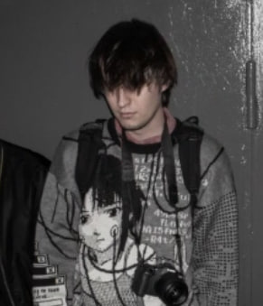

# База знаний медиа-центра 1/125

## О статье

Для начала поговорим почему этой страничке в интернете вообще нужно верить? Кто создатели? АНОНИМУСЫ? Да нет же! Давайте знакомиться:

### SRJT

[Сергей SRJT](https://t.me/serjojotaro) - новосибирский уличный фотограф и один из создателей медиа-центра 1/125. Фотограф колледжа с 2021 по 2025 год. Участник и призёр чемпионата "Профессионалы", конкурса "Студ-весна". В фотографии с 2020 года, а с камерой чуть меньше - с 2021. Начинал с фотографии домов, дошёл до стрита на популярных заброшках НСК.

<figure><picture><source srcset=".gitbook/assets/image (1).png" media="(prefers-color-scheme: dark)"></picture><figcaption></figcaption></figure>

## О чём статья?&#x20;

Материал в этой статье написан для тех, кто хотел бы начать свой путь в фотографии или просто познакомиться с этом мире чуть ближе. Начиная с самый базовых вопросов "Могу ли я начать фотографировать" до технических аспектов этого прекрасного ремесла. Написано оно такиме же "вчерашними" новичками в ~~ходьбе~~ фотографии  . Тут будут как и чисто технические моменты, которые вы можете прочитать в википедии или форумах, так и чистосердечное ИМХО авторов. С которым вы, кстати, можете быть несогласны ( и это вполне нормально! ).

Данная статья связана с обучением фотографов в медиа-центре, но не может его заменить! Потому что ничто не может заменить личную коммуникацию с товарищами по камере.&#x20;

